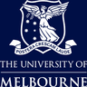

# Hi, I’m Hannah. I work on AI safety.

I am very interested in **robustness**. I have worked on showing the benefits of neurosymbolic models for robustness<a href="#r1">1</a>, how tool-augmented agents contribute to robustness in clinical triage scenarios<a href="#r2">2</a>, and on designing a white-box linear probe to predict robustness on AIMO-level math problems<a href="#r3">3</a>.

Since Fall 2026 I have also been working on a SPAR research project<a href="#r4">4</a>, designing a **follow-up questions** paradigm for **weak-to-strong monitoring**. I recently showed that follow-up questions help weaker monitors, especially in complex agent swarms as the swarm grows, but that weak models are poor at choosing good questions<a href="#r5">5</a>. Next, I will train a question-asking model on strong models’ question–answer interactions, and test the paradigm adversarially on a model organism built to give deceptive responses.

🏅 ALTA 2025 Best Paper  
🏅 CURE-Bench @ NeurIPS 2025 Open Science Award  
📍 Melbourne  
[hannahb160903@gmail.com](mailto:hannahb160903@gmail.com) · [LinkedIn](https://linkedin.com/in/hannahbansal) · [GitHub](https://github.com/hannahhb) · [All projects and publications](/projects/)

  Now
  <a href="https://sparai.org/projects/f26/recVHalQ4NlHvSbUC/"></a>

  Previously at
  
  
  
  

<ol class="refs">
  <li id="r1">Robustness of Neurosymbolic Reasoners on First-Order Logic Problems. ALTA 2025, Best Paper. <a href="https://aclanthology.org/2025.alta-main.1/">Paper</a></li>
  <li id="r2">CURE-Bench @ NeurIPS 2025, Open Science Award. <a href="https://curebench.ai/posters">Posters</a></li>
  <li id="r3"><a href="https://github.com/hannahhb/aimo_interp_segprobe/blob/main/paper/AIMO_Interp_Seg_Probe_2026.pdf">Fragile or Just Hard? Robustness Prediction from Reasoning Probes</a>. AIMO Interp @ NeurIPS 2026. <a href="https://github.com/hannahhb/aimo_interp_segprobe">Code</a></li>
  <li id="r4">Can Follow-up Questions Catch Missing Reasoning? SPAR Fall 2026, with Pierre-Luc St-Charles. <a href="https://sparai.org/projects/f26/recVHalQ4NlHvSbUC/">Project page</a></li>
  <li id="r5">Can Follow-Up Questions Help Weak-to-Strong Monitors for Swarms? Apart Research hackathon, Nov 2026. <a href="https://apartresearch.com/sprints/projects/can-followup-questions-help-weaktostrong-monitors-for-swarms-wpcsuqz0d4">Project page</a></li>
</ol>
